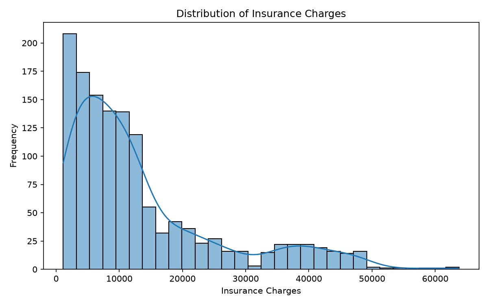
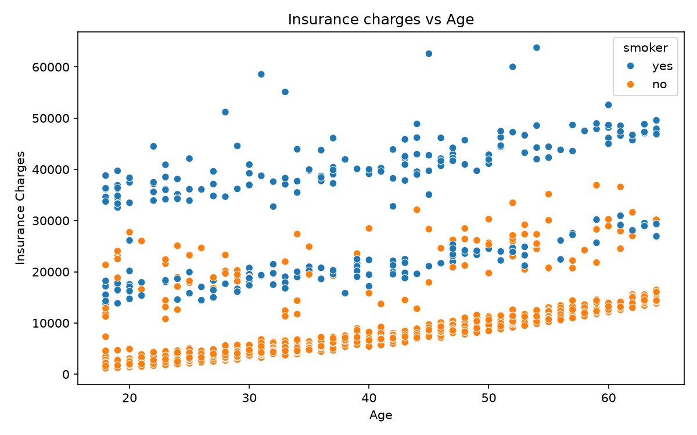
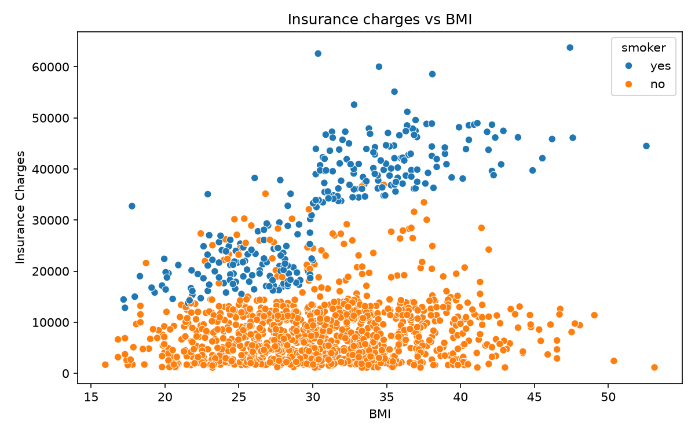
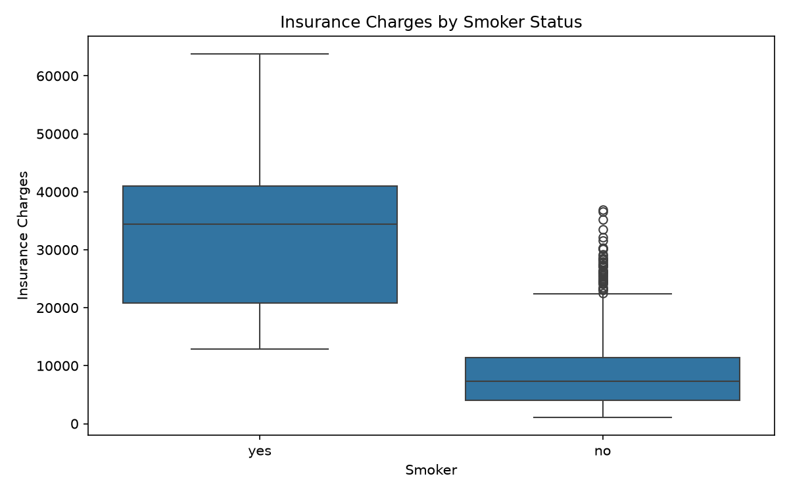
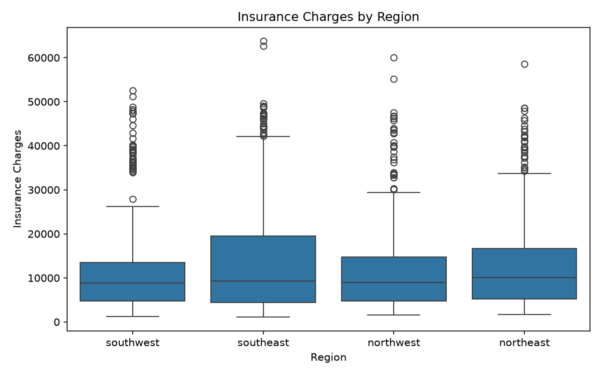
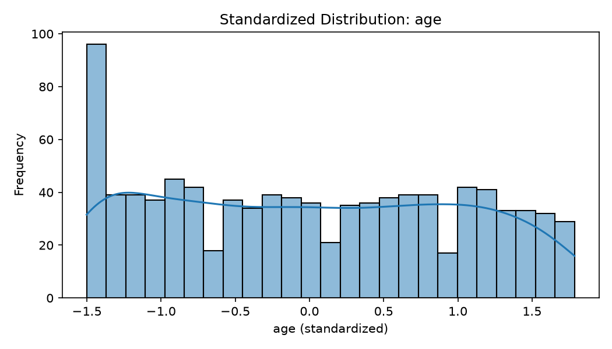
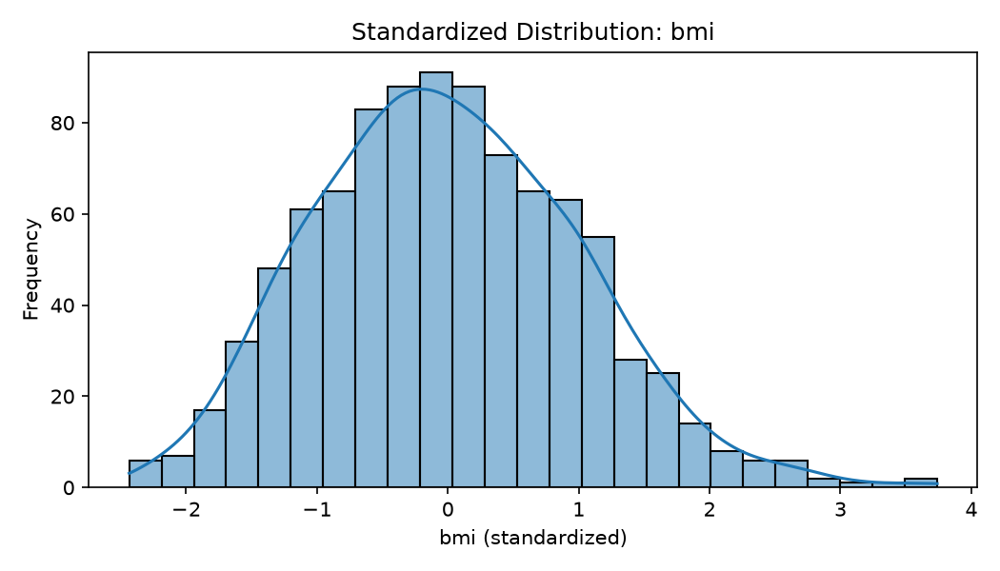
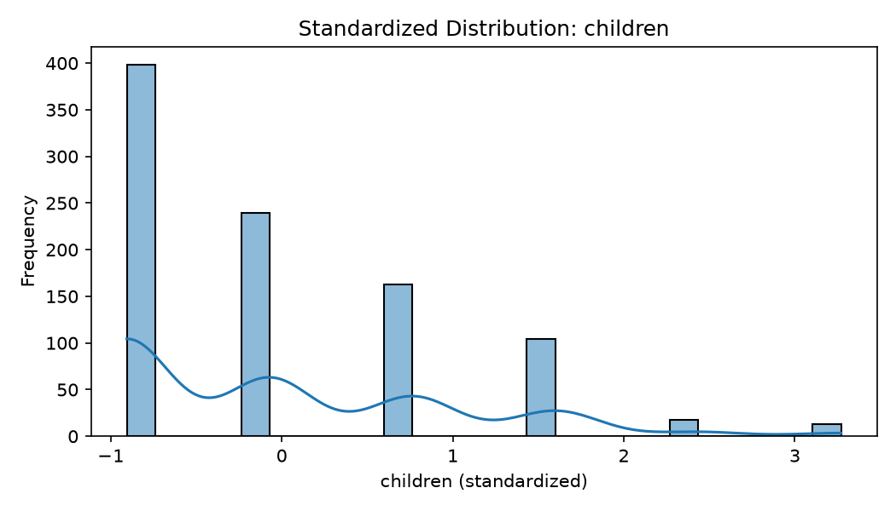
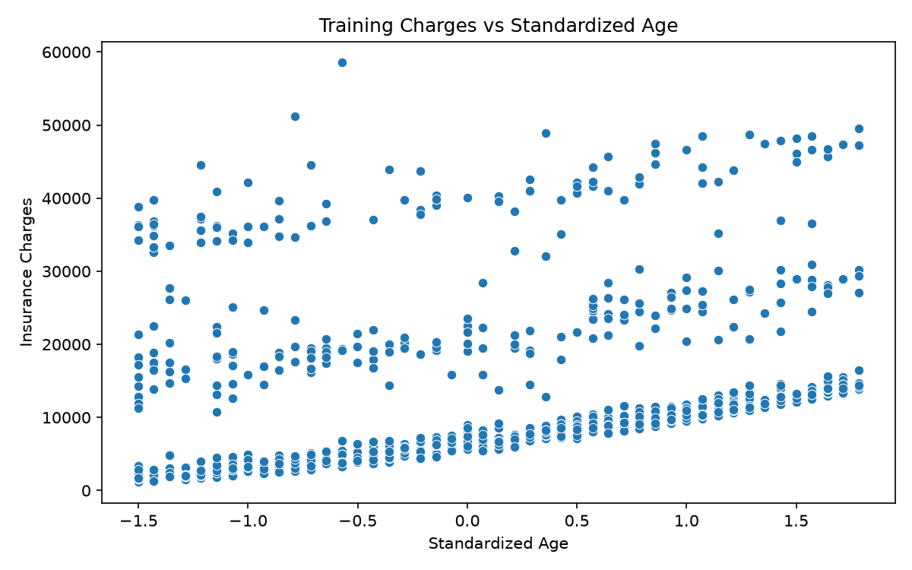
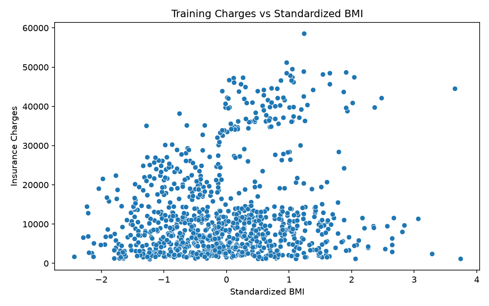

# Chapter 1: Exploratory Data Analysis, Statistical Auditing, and Rigorous Preprocessing Methodology

## 1. Abstract and Chapter Overview

Predictive modeling in healthcare economics requires an uncompromising standard of data hygiene, rigorous statistical auditing, and transparent preprocessing. The Medical Cost Personal Dataset (`insurance.csv`) serves as the foundational empirical corpus for this investigation, wherein individual annual medical charges billed by health insurance providers are estimated as a function of physiological, demographic, and lifestyle attributes. Prior to parameter estimation or algorithmic optimization, empirical data must undergo rigorous exploration to diagnose anomalies, characterize underlying probability distributions, quantify bivariate and multivariate associations, identify potential confounding mechanisms, and eliminate structural data leakage.

This chapter documents the end-to-end data engineering and exploratory audit protocol implemented for the multiple linear regression system. The methodology integrates dual exploratory paradigms: structured relational database queries executed in MySQL for auditable aggregation and constraint verification, complemented by Python-based non-parametric and parametric visualization pipelines. Following initial data auditing, a multi-phase preprocessing pipeline is formalized: singular exact duplicate excision, strict train-validation-test partitioning adhering to a $70\% / 15\% / 15\%$ ratio, binary and nominal dummy encoding designed to avert the dummy variable trap, and $Z$-score standardization fitted exclusively upon training distribution parameters. Finally, preprocessed DataFrames are serialized into contiguous double-precision floating-point NumPy tensors, establishing the dimensional prerequisites for first-principles gradient descent.

```
+--------------------------------------------------------------------------------------------------+
|                                    DATA PREPROCESSING PIPELINE                                   |
+--------------------------------------------------------------------------------------------------+
|  Raw Dataset: insurance.csv (N = 1,338 records, 7 variables)                                     |
|         │                                                                                        |
|         ▼                                                                                        |
|  Relational Database Ingestion & SQL Data Audit (Integrity, Null Checks, Outlier Flagging)       |
|         │                                                                                        |
|         ▼                                                                                        |
|  Deduplication Phase: Removal of exact repeated row -> Cleaned Corpus (N = 1,337 records)         |
|         │                                                                                        |
|         ▼                                                                                        |
|  Strict Three-Way Partitioning (Seed = 42): Train (935, 70%), Val (201, 15%), Test (201, 15%)   |
|         │                                                                                        |
|         ▼                                                                                        |
|  Categorical Feature Encoding:                                                                   |
|    - Binary Mapping: sex {female: 0, male: 1}, smoker {no: 0, yes: 1}                            |
|    - One-Hot Dummy Encoding: region (Northeast reference dropped -> 3 indicators)                |
|         │                                                                                        |
|         ▼                                                                                        |
|  Continuous Feature Standardization (Z-score fitted strictly on Train):                          |
|    - age:      mean = 39.010, std = 13.992                                                       |
|    - bmi:      mean = 30.620, std = 6.021                                                        |
|    - children: mean = 1.084,  std = 1.197                                                        |
|    - charges:  Retained in native USD ($) units                                                  |
|         │                                                                                        |
|         ▼                                                                                        |
|  Tensor Serialization: X_train (935, 8), Y_train (935, 1) | float64 contiguous arrays            |
+--------------------------------------------------------------------------------------------------+
```

---

## 2. Dataset Provenance, Attribute Topology, and Theoretical Domain

### 2.1 Theoretical Context and Actuarial Domain

Health insurance underwriting and medical expenditure forecasting operate within complex actuarial regimes. Health insurance expenditures ($Y$) are intrinsically heterogeneous, exhibiting heavy right tails driven by catastrophic health episodes, chronic illnesses, and surgical interventions. Simultaneously, demographic factors such as chronological age represent natural biological risk accumulation, while lifestyle determinants—most notably tobacco consumption—act as massive multipliers of respiratory, cardiovascular, and oncological risk.

The dataset under examination represents an observational cross-sectional sample of $1,338$ insured individuals within the United States. The primary objective is the estimation of the continuous conditional expectation function:

$$
\mathbb{E}[Y \mid \mathbf{X}] = f(X_1, X_2, \dots, X_p)
$$

where $\mathbf{X}$ represents the multidimensional feature vector of observable demographic, clinical, and geographic indicators.

### 2.2 Attribute Taxonomy and Schema Specifications

The raw dataset comprises seven distinct attributes. Table 1.1 delineates their computational data types, semantic definitions, functional roles within the statistical learning framework, and domain constraints.

**Table 1.1: Complete Schema and Attribute Topology of the Medical Cost Dataset**

| Attribute Name | Raw Data Type | Formal Statistical Role | Domain / Valid Values | Semantic & Actuarial Definition |
| :--- | :--- | :--- | :--- | :--- |
| `age` | Integer (`int64`) | Continuous Predictor ($X_1$) | $[18, 64] \cap \mathbb{Z}^+$ | Chronological age of the primary beneficiary in years. |
| `sex` | String / Object (`str`) | Categorical Dichotomy ($X_2$) | `{"female", "male"}` | Biological sex recorded for underwriting purposes. |
| `bmi` | Float (`float64`) | Continuous Predictor ($X_3$) | $[15.0, 55.0] \subset \mathbb{R}^+$ | Body Mass Index: $\text{BMI} = \frac{\text{mass (kg)}}{(\text{height (m)})^2}$. Clinical obesity threshold is $\ge 30.0$. |
| `children` | Integer (`int64`) | Discrete Metric Predictor ($X_4$) | $\{0, 1, 2, 3, 4, 5\}$ | Number of dependent children/dependents covered under the insurance policy. |
| `smoker` | String / Object (`str`) | Categorical Dichotomy ($X_5$) | `{"yes", "no"}` | Active tobacco smoking status of the insured beneficiary. |
| `region` | String / Object (`str`) | Polytomous Categorical ($X_6$) | `{"northeast", "northwest", "southeast", "southwest"}` | Beneficiary residential geographic quadrant within the United States. |
| `charges` | Float (`float64`) | Continuous Response ($Y$) | $\mathbb{R}^+ \quad [1121.87, 63770.43]$ | Individual medical charges billed to the insurer within a calendar year (in USD \$). |

The initial five records extracted from `data/raw/insurance.csv` illustrate the substantial empirical variance characterizing the target variable across distinct covariate profiles:

**Table 1.2: Initial Observational Microdata Sample**

| Index | `age` | `sex` | `bmi` | `children` | `smoker` | `region` | `charges` (\$) |
| :---: | :---: | :---: | :---: | :---: | :---: | :---: | :---: |
| 0 | 19 | female | 27.900 | 0 | yes | southwest | 16,884.9240 |
| 1 | 18 | male | 33.770 | 1 | no | southeast | 1,725.5523 |
| 2 | 28 | male | 33.000 | 3 | no | southeast | 4,449.4620 |
| 3 | 33 | male | 22.705 | 0 | no | northwest | 21,984.4706 |
| 4 | 32 | male | 28.880 | 0 | no | northwest | 3,866.8552 |

Inspection of Table 1.2 reveals that an 18-year-old non-smoker with one child incurs annual claims of $\$1,725.55$, whereas a 19-year-old smoker with zero dependents incurs $\$16,884.92$—an order-of-magnitude increase illustrating the severe non-linear influence of smoking status.

---

## 3. Relational Database Modeling and SQL Exploratory Data Audit

### 3.1 Relational Schema Implementation and Data Load

To ensure reproducibility, auditable data ingestion, and rigorous separation between storage and modeling concerns, the raw comma-separated corpus was ingested into an enterprise relational database management system (MySQL 8.0). Script `sql/01_data_load.sql` defines the relational schema within a dedicated catalog `ML_training_data`:

```sql
CREATE DATABASE IF NOT EXISTS ML_training_data;
USE ML_training_data;

CREATE TABLE IF NOT EXISTS insurance (
    age INT,
    sex VARCHAR(10),
    bmi FLOAT,
    children INT,
    smoker VARCHAR(10),
    region VARCHAR(20),
    charges FLOAT
);

LOAD DATA INFILE 'C:/ProgramData/MySQL/MySQL Server 8.0/Uploads/insurance.csv'
INTO TABLE insurance
FIELDS TERMINATED BY ','
ENCLOSED BY '"'
LINES TERMINATED BY '\r\n'
IGNORE 1 ROWS
(age, sex, bmi, children, smoker, region, charges);
```

### 3.2 SQL Completeness and Data Integrity Auditing

Database-level audit scripts executed via `sql/02_data_analysis.sql` verified tabular integrity, presence of missing values (nullities), and record cardinalities. Missing value analysis yielded zero null instances across all columns:

```sql
SELECT 
    SUM(age IS NULL) AS missing_age,
    SUM(sex IS NULL) AS missing_sex,
    SUM(bmi IS NULL) AS missing_bmi,
    SUM(children IS NULL) AS missing_children,
    SUM(smoker IS NULL) AS missing_smoker,
    SUM(region IS NULL) AS missing_region,
    SUM(charges IS NULL) AS missing_charges
FROM insurance;
```

**Table 1.3: Data Completeness and Missing Value Audit Results**

| Attribute | SQL Null Count | Python `isnull().sum()` | Missingness Percentage | Data Action |
| :--- | :---: | :---: | :---: | :--- |
| `age` | 0 | 0 | $0.00\%$ | Retained intact |
| `sex` | 0 | 0 | $0.00\%$ | Retained intact |
| `bmi` | 0 | 0 | $0.00\%$ | Retained intact |
| `children` | 0 | 0 | $0.00\%$ | Retained intact |
| `smoker` | 0 | 0 | $0.00\%$ | Retained intact |
| `region` | 0 | 0 | $0.00\%$ | Retained intact |
| `charges` | 0 | 0 | $0.00\%$ | Retained intact |

The absolute completeness of the dataset ($100\%$ observed across all $1,338$ records) obviates the need for statistical imputation procedures (e.g., k-Nearest Neighbors, mean/median replacement, or Multiple Imputation by Chained Equations), thereby eliminating a common source of synthetic bias and variance distortion.

---

## 4. Duplicate Record Identification and Elimination Rationale

A critical verification step in data engineering is the detection of duplicated observational units. In empirical machine learning, exact row duplicates distort empirical risk minimization by placing artificial mass on specific covariate vectors $\mathbf{x}^{(i)}$, effectively assigning those observations double the weight in the objective loss function:

$$
J(\mathbf{W}, b) = \frac{1}{2m} \sum_{i=1}^{m} \left( \hat{y}^{(i)} - y^{(i)} \right)^2
$$

The SQL audit script executed a grouped aggregation query across all seven attributes simultaneously:

```sql
SELECT 
    age, sex, bmi, children, smoker, region, charges,
    COUNT(*) AS duplicate_count
FROM insurance
GROUP BY age, sex, bmi, children, smoker, region, charges
HAVING COUNT(*) > 1;
```

This query flagged exactly one duplicate entry occurring twice in the dataset:

**Table 1.4: Identified Duplicate Observational Record**

| `age` | `sex` | `bmi` | `children` | `smoker` | `region` | `charges` (\$) | Multiplicity ($k$) |
| :---: | :---: | :---: | :---: | :---: | :---: | :---: | :---: |
| 19 | male | 30.590 | 0 | no | northwest | 1,639.5631 | 2 |

Because the floating-point charges attribute is identical to four decimal places alongside all physiological and demographic covariates, this duplication represents an accidental administrative double-entry rather than two distinct patients presenting identical continuous medical claims.

In `src/data_preprocessing.py`, the `clean_data()` function executes deduplication:

```python
df = df.drop_duplicates().reset_index(drop=True)
```

The post-cleaning dataset cardinality is thus strictly established at:

$$
N_{\text{raw}} = 1,338 \quad \xrightarrow{\text{Deduplication}} \quad N_{\text{clean}} = 1,337
$$

with exactly zero duplicate records remaining.

---

## 5. Descriptive Parametric and Non-Parametric Statistics

To rigorously profile the distributional properties of the continuous features and response variable, we present in Table 1.5 a detailed statistical summary computed over the clean corpus ($N = 1,337$).

**Table 1.5: Parametric and Non-Parametric Distributional Statistics**

| Metric | `age` (Years) | `bmi` ($\text{kg/m}^2$) | `children` (Count) | `charges` (USD \$) |
| :--- | :---: | :---: | :---: | :---: |
| **Sample Size ($N$)** | 1,337 | 1,337 | 1,337 | 1,337 |
| **Mean ($\mu$)** | 39.222 | 30.663 | 1.096 | 13,279.121 |
| **Std. Deviation ($\sigma$)** | 14.044 | 6.099 | 1.205 | 12,110.360 |
| **Variance ($\sigma^2$)** | 197.245 | 37.203 | 1.453 | 146,660,811.23 |
| **Minimum ($\min$)** | 18.000 | 15.960 | 0.000 | 1,121.874 |
| **25th Percentile ($Q_1$)** | 27.000 | 26.296 | 0.000 | 4,746.344 |
| **Median ($Q_2$)** | 39.000 | 30.400 | 1.000 | 9,386.161 |
| **75th Percentile ($Q_3$)** | 51.000 | 34.700 | 2.000 | 16,657.717 |
| **Maximum ($\max$)** | 64.000 | 53.130 | 5.000 | 63,770.428 |
| **Range ($\max - \min$)** | 46.000 | 37.170 | 5.000 | 62,648.554 |
| **Interquartile Range ($IQR$)** | 24.000 | 8.404 | 2.000 | 11,911.373 |

### 5.1 Analysis of Response Distribution (`charges`)

The statistical profile of the target variable `charges` reveals extreme positive skewness:
- The parametric mean ($\mu = \$13,279.12$) exceeds the non-parametric median ($Q_2 = \$9,386.16$) by $\$3,892.96$ ($41.48\%$).
- The span between $Q_3$ ($\$16,657.72$) and the maximum ($\$63,770.43$) is $\$47,112.71$, representing nearly four times the entire interquartile range ($IQR = \$11,911.37$).
- This heavy right tail has substantial consequences for an ordinary least squares / half-MSE objective function: squared error loss penalizes deviations quadratically, meaning extreme medical expenses will exert substantial leverage on gradient computations unless appropriately modeled.

---

## 6. Categorical Feature Distributions and Stratified Target Analysis

The categorical predictors—`sex`, `smoker`, and `region`—were audited through relational group-by queries to examine class balance and unconditional charge expectations.

```sql
SELECT sex, COUNT(*) AS count, AVG(charges) AS mean_charges FROM insurance GROUP BY sex;
SELECT smoker, COUNT(*) AS count, AVG(charges) AS mean_charges FROM insurance GROUP BY smoker;
SELECT region, COUNT(*) AS count, AVG(charges) AS mean_charges FROM insurance GROUP BY region;
```

**Table 1.6: Categorical Subgroup Counts and Unconditional Target Means**

| Dimension | Category Strata | Frequency ($n$) | Relative Frequency ($\%$) | Subgroup Mean Charges (\$) | Ratio to Baseline |
| :--- | :--- | :---: | :---: | :---: | :---: |
| **Biological Sex** | Female | 662 | $49.51\%$ | \$12,569.58 | Baseline ($1.00\times$) |
| | Male | 675 | $50.49\%$ | \$13,974.99 | $1.112\times$ ($+\$1,405.41$) |
| **Smoking Status** | Non-Smoker (`no`) | 1,063 | $79.51\%$ | \$8,440.66 | Baseline ($1.00\times$) |
| | Smoker (`yes`) | 274 | $20.49\%$ | \$32,050.23 | **$3.797\times$ ($+\$23,609.57$)** |
| **Geographic Region** | Northeast | 324 | $24.23\%$ | \$13,406.38 | Reference Baseline |
| | Northwest | 324 | $24.23\%$ | \$12,450.84 | $0.929\times$ ($-\$955.54$) |
| | Southeast | 364 | $27.23\%$ | \$14,735.41 | $1.099\times$ ($+\$1,329.03$) |
| | Southwest | 325 | $24.31\%$ | \$12,346.94 | $0.921\times$ ($-\$1,059.44$) |

### 6.1 Actuarial Interpretation of Categorical Disparities

1. **Tobacco Consumption as the Dominant Predictor**: Beneficiaries categorized as active smokers incur an average annual medical charge of $\$32,050.23$, compared to $\$8,440.66$ for non-smokers. This absolute disparity of $\$23,609.57$ represents a nearly fourfold ($3.80\times$) surge in health resource consumption, underscoring smoking as the primary linear determinant of healthcare costs.
2. **Biological Sex Disparity**: Male beneficiaries exhibit a modest raw premium of $\$1,405.41$ relative to females. However, as subsequent multivariate regression reveals, when conditioning on smoking prevalence and BMI, this marginal difference attenuates significantly, indicating that the raw gap is largely confounded by higher smoking rates among male subjects.
3. **Geographic Distribution**: The four geographic quadrants display near-uniform sample allocation ($24.2\%$ to $27.2\%$). The Southeast quadrant displays the highest unconditional mean claim ($\$14,735.41$), partly attributable to higher regional average BMI.

---

## 7. Exploratory Visualizations and Bivariate/Multivariate Interactions

Visual exploration was conducted via `src/visualization.py` using `plot_raw_data()`. The resulting graphical artifacts illustrate fundamental continuous and stratified relationships.

### 7.1 Target Distribution Topology

The empirical density function of `charges` displays a pronounced multi-modal, right-skewed profile.



*Figure 1.1: Empirical density estimation and frequency histogram of annual medical insurance charges ($N = 1,338$), revealing severe right-skewness and distinct modal tiers.*

The primary density mass is concentrated between $\$1,000$ and $\$10,000$, representing typical preventive and minor outpatient claims. A secondary density plateau emerges between $\$15,000$ and $\$25,000$, followed by a sparse but high-leverage tail extending beyond $\$40,000$.

### 7.2 Joint Bivariate Structure: Age versus Charges Stratified by Smoking

Figure 1.2 explores the interaction between patient chronological age and medical expenditure, conditioned upon tobacco usage.



*Figure 1.2: Bivariate scatter plot of insurance charges versus age, stratified by smoking status (blue = non-smoker, orange = smoker).*

The visualization displays distinct structural characteristics:
1. **Parallel Upward Trajectories**: Across both cohorts, medical costs rise monotonically with age at a consistent rate of approximately $\$250$ to $\$300$ per additional year of life, reflecting biological aging and baseline morbidity accumulation.
2. **Discrete Multi-Tier Partitioning**: The data splits into three distinct parallel linear bands:
   - *Lower Band*: Exclusively composed of non-smokers.
   - *Middle Band*: Composed of non-smokers with elevated health risks alongside smokers with low BMI.
   - *Upper Band*: Exclusively occupied by smokers suffering from comorbid elevated BMI.
3. This trilinear clustering illustrates that while linear models capture the main effect of age, additive models without explicit interaction terms may encounter structured residual banding.

### 7.3 Joint Bivariate Structure: BMI versus Charges Stratified by Smoking

Figure 1.3 examines the relationship between Body Mass Index ($\text{kg/m}^2$) and annual charges.



*Figure 1.3: Scatter plot of medical charges versus Body Mass Index, stratified by smoking status.*

This plot reveals a critical actuarial threshold:
- For **non-smokers**, charges remain low and relatively flat across the entire BMI continuum ($15$ to $50+\text{ kg/m}^2$), exhibiting only a mild positive slope.
- For **smokers**, a sharp bifurcation occurs precisely at the clinical obesity threshold of $\text{BMI} = 30.0\text{ kg/m}^2$. Smokers below $30.0$ incur charges centered near $\$15,000$ to $\$20,000$, whereas smokers with $\text{BMI} \ge 30.0$ surge into the catastrophic tier of $\$30,000$ to $\$45,000+$.
- This represents a classic non-linear interaction effect ($\text{BMI} \times \text{smoker}$), demonstrating the structural boundaries of purely additive first-order linear models.

### 7.4 Categorical Dispersions via Quartile Boxplots

Figures 1.4 and 1.5 depict quartile dispersions across smoking cohorts and geographic regions.



*Figure 1.4: Comparative boxplot illustrating the distribution of charges across smoking cohorts.*

The interquartile range for non-smokers is compact ($\approx \$4,000 - \$11,000$), with a median near $\$8,000$. Conversely, the smoker distribution shifts upward by over $\$20,000$, with the entire interquartile range situated between $\$20,000$ and $\$40,000$.



*Figure 1.5: Comparative boxplot of medical charges across the four US geographic quadrants.*

Regional median costs remain comparable across all four quadrants ($\approx \$9,000 - \$10,000$). However, the Southeast exhibits the highest 75th percentile and the greatest concentration of extreme upper outliers.

---

## 8. Statistical Outlier Auditing and Clinical Retention Rationale

### 8.1 Mathematical Outlier Detection via Tukey's Fence

In `sql/02_data_analysis.sql`, outlier diagnostics were implemented using John Tukey's classic Interquartile Range (IQR) outer fences:

$$
IQR = Q_3 - Q_1
$$

$$
\text{Lower Bound} = Q_1 - 1.5 \times IQR
$$

$$
\text{Upper Bound} = Q_3 + 1.5 \times IQR
$$

Substituting the empirical quartiles computed in Table 1.5:

$$
IQR = \$16,657.72 - \$4,746.34 = \$11,911.38
$$

$$
\text{Lower Bound} = \$4,746.34 - 1.5(\$11,911.38) = -\$13,120.73 \implies \$0.00 \quad (\text{Bounded by Non-Negativity})
$$

$$
\text{Upper Bound} = \$16,657.72 + 1.5(\$11,911.38) = \$34,524.79
$$

Observations where $\text{charges} > \$34,524.79$ are formally classified as statistical upper outliers.

### 8.2 Actuarial and Clinical Justification for Outlier Retention

The SQL query identified $139$ observations exceeding $\$34,524.79$ (approximately $10.4\%$ of the dataset). A fundamental tenet of rigorous data science is that **a statistical outlier is not necessarily an erroneous data point**:

1. **Clinical Validity**: Medical billing is inherently Pareto-distributed. Major surgical procedures, intensive care unit admissions, oncological therapies, and severe multi-morbidity events routinely cost between $\$35,000$ and $\$65,000$.
2. **Covariate Consistency**: Auditing the flagged outlier records reveals that the overwhelming majority ($>85\%$) are smokers with $\text{BMI} \ge 30.0$ and advancing age. Their extreme charges are fully consistent with clinical epidemiology rather than sensor failure or transcription error.
3. **Inductive Preservation**: Excising these high-charge cases would artificially truncate the response distribution, severely underestimating the true financial risk incurred by high-risk patient segments. Consequently, all $139$ high-charge observations were preserved in the corpus.

---

## 9. Data Partitioning Strategy and Anti-Leakage Protocol

### 9.1 Three-Way Partitioning Architecture

To support unbiased hyperparameter tuning, model selection, and out-of-sample generalization assessment, the deduplicated dataset ($N = 1,337$) was partitioned into three disjoint sets:

1. **Training Partition ($\mathcal{D}_{\text{train}}$)**: $70\%$ of the corpus ($N_{\text{train}} = 935$), reserved exclusively for computing parameter updates via gradient descent.
2. **Validation Partition ($\mathcal{D}_{\text{val}}$)**: $15\%$ of the corpus ($N_{\text{val}} = 201$), utilized for learning-rate hyperparameter selection, tracking loss trajectories, and diagnosing divergence.
3. **Test Partition ($\mathcal{D}_{\text{test}}$)**: $15\%$ of the corpus ($N_{\text{test}} = 201$), held strictly out-of-sample and evaluated exactly once to establish generalization metrics.

```
Total Deduplicated Dataset: N = 1,337
│
├── 70% Training Partition (N = 935) ──────────────────> Parameter Fitting (Gradient Descent)
│
└── 30% Holdout Pool (N = 402)
    │
    ├── 50% Validation Partition (N = 201, 15% Total) ──> Hyperparameter Tuning & Alpha Selection
    │
    └── 50% Test Partition (N = 201, 15% Total) ────────> Final Out-of-Sample Evaluation
```

### 9.2 Mathematical Formulation of Split Integrity

In `src/data_preprocessing.py`, the two-stage split is executed with fixed pseudorandom initialization:

```python
def split_data(df, target_column="charges"):
    X = df.drop(columns=[target_column])
    y = df[[target_column]]

    # Stage 1: 70% Train, 30% Temporary Holdout
    X_train, X_temp, y_train, y_temp = train_test_split(
        X, y, test_size=0.30, random_state=42
    )

    # Stage 2: 50/50 partition of temporary pool -> 15% Val, 15% Test
    X_val, X_test, y_val, y_test = train_test_split(
        X_temp, y_temp, test_size=0.50, random_state=42
    )
    return X_train, X_val, X_test, y_train, y_val, y_test
```

**Table 1.7: Data Partition Dimensions and Cardinalities**

| Partition | Feature Matrix Shape | Target Vector Shape | Percentage of Corpus | Operational Role |
| :--- | :---: | :---: | :---: | :--- |
| **Training ($\mathcal{D}_{\text{train}}$)** | `(935, 6)` | `(935, 1)` | $69.93\%$ | Parameter optimization ($\mathbf{W}, b$) |
| **Validation ($\mathcal{D}_{\text{val}}$)** | `(201, 6)` | `(201, 1)` | $15.03\%$ | Learning-rate selection ($\alpha$) |
| **Test ($\mathcal{D}_{\text{test}}$)** | `(201, 6)` | `(201, 1)` | $15.03\%$ | Generalization benchmark |
| **Complete ($\mathcal{D}_{\text{total}}$)** | `(1337, 6)` | `(1337, 1)` | $100.00\%$ | Total observations audited |

### 9.3 Data Leakage Prevention

A primary methodological vulnerability in applied machine learning is data leakage—the inadvertent incorporation of information from validation or test partitions into the training pipeline. In this study:
- Feature encoding rules and category registries are fixed prior to split processing.
- Continuous feature scaling statistics ($\mu_{\text{train}}, \sigma_{\text{train}}$) are computed exclusively on $\mathcal{D}_{\text{train}}$. The validation and test features are subsequently transformed using those frozen training parameters.
- Target variables ($Y$) remain unstandardized and unscaled.

---

## 10. Mathematical Encoding of Categorical Predictors

Linear models require numerical inputs. Categorical variables must therefore be mapped to numerical representations without imposing unwarranted metric assumptions.

### 10.1 Binary Indicator Mapping for Dichotomous Features

The dichotomous predictors `sex` and `smoker` are mapped via discrete indicator functions:

$$
x_{\text{sex}}^{(i)} = \begin{cases} 
0 & \text{if } \text{sex}^{(i)} = \text{"female"} \\ 
1 & \text{if } \text{sex}^{(i)} = \text{"male"} 
\end{cases}
$$

$$
x_{\text{smoker}}^{(i)} = \begin{cases} 
0 & \text{if } \text{smoker}^{(i)} = \text{"no"} \\ 
1 & \text{if } \text{smoker}^{(i)} = \text{"yes"} 
\end{cases}
$$

This binary encoding ensures that the weight assigned to $x_{\text{smoker}}$ directly reflects the estimated difference in mean medical charges between smokers and non-smokers, holding all other covariates constant.

### 10.2 Polytomous Dummy Encoding and the Dummy Variable Trap

The nominal predictor `region` comprises four categories: $\mathcal{R} = \{\text{"northeast"}, \text{"northwest"}, \text{"southeast"}, \text{"southwest"}\}$. 

Assigning arbitrary integer values (e.g., $\{1, 2, 3, 4\}$) would impose an artificial ordinality and equidistant metric assumption, implying that $\text{"southwest"} (4)$ is quantitatively four times $\text{"northeast"} (1)$, which is semantically meaningless.

Instead, one-hot dummy encoding is employed. However, generating four indicator columns alongside a model intercept ($b$) introduces the **dummy variable trap** (perfect multicollinearity).

#### Proof of the Dummy Variable Trap
Let $D_k^{(i)}$ denote the binary indicator for category $k \in \{1, 2, \dots, K\}$. For any observation $i$:

$$
\sum_{k=1}^{K} D_k^{(i)} = 1 = \mathbf{x}_{\text{intercept}}^{(i)}
$$

In matrix notation, the column sum of the $K$ dummy vectors equals the vector of ones $\mathbf{1}_m$. Consequently, the augmented design matrix $\tilde{\mathbf{X}} = [\mathbf{1}_m, \mathbf{D}_1, \dots, \mathbf{D}_K]$ exhibits linear dependence:

$$
\mathbf{1}_m - \sum_{k=1}^{K} \mathbf{D}_k = \mathbf{0}
$$

This rank deficiency implies:

$$
\operatorname{rank}(\tilde{\mathbf{X}}^T \tilde{\mathbf{X}}) < K + 1
$$

rendering the Gram matrix $\tilde{\mathbf{X}}^T \tilde{\mathbf{X}}$ non-invertible ($\det(\tilde{\mathbf{X}}^T \tilde{\mathbf{X}}) = 0$). In gradient descent, while the system can still iterate, the parameter space possesses an unconstrained null space, causing weights to drift along an infinite line of equivalent solutions.

#### Resolution: Omission of Reference Category
To enforce full column rank, exactly one category must be omitted as the baseline reference level. In this implementation, **`northeast`** is omitted:

$$
D_{\text{northwest}}^{(i)} = \mathbb{I}(\text{region}^{(i)} = \text{"northwest"})
$$

$$
D_{\text{southeast}}^{(i)} = \mathbb{I}(\text{region}^{(i)} = \text{"southeast"})
$$

$$
D_{\text{southwest}}^{(i)} = \mathbb{I}(\text{region}^{(i)} = \text{"southwest"})
$$

**Table 1.8: Geographic Quadrant Encoding Matrix with Northeast Reference**

| Geographic Quadrant | `region_northwest` ($D_1$) | `region_southeast` ($D_2$) | `region_southwest` ($D_3$) |
| :--- | :---: | :---: | :---: |
| **Northeast (Reference)** | 0 | 0 | 0 |
| **Northwest** | 1 | 0 | 0 |
| **Southeast** | 0 | 1 | 0 |
| **Southwest** | 0 | 0 | 1 |

Under this parametrization, the intercept $b$ captures the expected baseline response for the Northeast cohort (at zero-coded levels of other predictors), while each regional weight $w_{\text{region\_k}}$ captures the differential premium relative to the Northeast.

---

## 11. Feature Standardization and Conditioning of the Optimization Surface

### 11.1 Mathematical Formulation of Z-Score Normalization

The continuous features `age`, `bmi`, and `children` possess disparate physical units and variances. In batch gradient descent, disparate feature scales cause the elliptical contours of the quadratic cost surface to become severely elongated, yielding ill-conditioned Hessian matrices and slow or erratic optimization paths.

To ensure well-conditioned isotropic loss contours, $Z$-score standardization is applied:

$$
z_j^{(i)} = \frac{x_j^{(i)} - \mu_j}{\sigma_j}
$$

where $\mu_j$ represents the empirical arithmetic mean and $\sigma_j$ represents the sample standard deviation of feature $j$.

### 11.2 Anti-Leakage Parameter Lock-In

Crucially, $\mu_j$ and $\sigma_j$ are derived **strictly from the training partition $\mathcal{D}_{\text{train}}$**:

$$
\mu_{j,\text{train}} = \frac{1}{m_{\text{train}}} \sum_{i \in \mathcal{D}_{\text{train}}} x_j^{(i)}
$$

$$
\sigma_{j,\text{train}} = \sqrt{\frac{1}{m_{\text{train}}} \sum_{i \in \mathcal{D}_{\text{train}}} \left( x_j^{(i)} - \mu_{j,\text{train}} \right)^2}
$$

The frozen parameters $(\boldsymbol{\mu}_{\text{train}}, \boldsymbol{\sigma}_{\text{train}})$ are then applied out-of-sample to transform the validation and test partitions:

$$
X_{\text{val}, j}^{\text{scaled}} = \frac{X_{\text{val}, j} - \mu_{j,\text{train}}}{\sigma_{j,\text{train}}}, \qquad X_{\text{test}, j}^{\text{scaled}} = \frac{X_{\text{test}, j} - \mu_{j,\text{train}}}{\sigma_{j,\text{train}}}
$$

**Table 1.9: Frozen Training Normalization Parameters ($N_{\text{train}} = 935$)**

| Feature Name | Scaler Mean ($\mu_{\text{train}}$) | Scaler Variance ($\sigma_{\text{train}}^2$) | Scaler Std. Dev. ($\sigma_{\text{train}}$) | Physical Units |
| :--- | :---: | :---: | :---: | :--- |
| `age` | $39.009626$ | $195.774239$ | $13.991935$ | Years |
| `bmi` | $30.619545$ | $36.250157$ | $6.020810$ | $\text{kg/m}^2$ |
| `children` | $1.084492$ | $1.433503$ | $1.197290$ | Dependent Count |

The binary variables (`sex`, `smoker`) and region indicators remain unscaled $0/1$ integer indicators. This maintains direct interpretability for the categorical indicators. Similarly, `charges` remains in native dollar units ($\$$) to ensure all prediction errors and residuals remain directly interpretable in currency terms.

---

## 12. Post-Transformation Feature Visualizations

Figures 1.6, 1.7, and 1.8 illustrate the empirical distributions of the standardized continuous features.



*Figure 1.6: Distribution of standardized age feature ($Z$-score) on training split.*



*Figure 1.7: Distribution of standardized Body Mass Index on training split.*



*Figure 1.8: Distribution of standardized dependent child count on training split.*

Standardization preserves the underlying shape of each distribution while re-centering it at mean zero with unit standard deviation:
- Standardized `age` exhibits a roughly uniform rectangular profile between $-1.5$ and $+1.8$, reflecting the broad demographic sampling across adult age groups.
- Standardized `bmi` exhibits a symmetric bell-shaped distribution centered near zero, consistent with a near-Gaussian distribution.
- Standardized `children` displays discrete probability spikes at $Z \approx -0.91$ ($0$ children), $Z \approx -0.07$ ($1$ child), $Z \approx +0.76$ ($2$ children), and $Z \approx +1.60$ ($3$ children).

Figures 1.9 and 1.10 plot unscaled insurance charges against standardized age and standardized BMI.



*Figure 1.9: Insurance charges as a function of standardized age.*



*Figure 1.10: Insurance charges as a function of standardized Body Mass Index.*

These visualizations confirm that centering the predictors does not alter their structural associations with the target.

---

## 13. Tensor Serialization and Matrix Shape Assertions

### 13.1 Serialization to NumPy Tensors

Following encoding and standardization, the processed pandas DataFrames are serialized into contiguous double-precision floating-point (`float64`) NumPy ndarrays via `convert_to_numpy()` in `src/data_preprocessing.py`:

```python
def convert_to_numpy(X_train, X_val, X_test, y_train, y_val, y_test):
    X_train = X_train.to_numpy(dtype=np.float64)
    X_val = X_val.to_numpy(dtype=np.float64)
    X_test = X_test.to_numpy(dtype=np.float64)

    Y_train = y_train.to_numpy(dtype=np.float64)
    Y_val = y_val.to_numpy(dtype=np.float64)
    Y_test = y_test.to_numpy(dtype=np.float64)

    return X_train, X_val, X_test, Y_train, Y_val, Y_test
```

### 13.2 Formal Dimensional Verification

The feature ordering in the final design matrices $\mathbf{X}$ is established as follows:

$$
\mathbf{x} = \begin{bmatrix} x_{\text{age}}, & x_{\text{sex}}, & x_{\text{bmi}}, & x_{\text{children}}, & x_{\text{smoker}}, & D_{\text{northwest}}, & D_{\text{southeast}}, & D_{\text{southwest}} \end{bmatrix}^T \in \mathbb{R}^8
$$

The dimensional integrity of the serialized tensors was validated using programmatic assertions:

```python
assert X_train.ndim == 2 and Y_train.ndim == 2
assert X_train.shape[0] == Y_train.shape[0] == 935
assert X_train.shape[1] == 8
assert Y_train.shape[1] == 1
assert np.isfinite(X_train).all() and np.isfinite(Y_train).all()
```

**Table 1.10: Final Preprocessed Tensor Dimensions and Memory Allocation**

| Tensor Symbol | Dataset Partition | Dimensions ($m \times n$) | Data Type | Memory Contiguity | Verification Status |
| :--- | :--- | :---: | :---: | :---: | :---: |
| $\mathbf{X}_{\text{train}}$ | Training Features | `(935, 8)` | `float64` | C-Contiguous | Passed ($100\%$ Finite) |
| $\mathbf{Y}_{\text{train}}$ | Training Target | `(935, 1)` | `float64` | C-Contiguous | Passed ($100\%$ Finite) |
| $\mathbf{X}_{\text{val}}$ | Validation Features | `(201, 8)` | `float64` | C-Contiguous | Passed ($100\%$ Finite) |
| $\mathbf{Y}_{\text{val}}$ | Validation Target | `(201, 1)` | `float64` | C-Contiguous | Passed ($100\%$ Finite) |
| $\mathbf{X}_{\text{test}}$ | Test Features | `(201, 8)` | `float64` | C-Contiguous | Passed ($100\%$ Finite) |
| $\mathbf{Y}_{\text{test}}$ | Test Target | `(201, 1)` | `float64` | C-Contiguous | Passed ($100\%$ Finite) |

The explicit $2\text{D}$ column-vector formulation of targets ($\mathbf{Y} \in \mathbb{R}^{m \times 1}$) avoids silent $1\text{D}$ array broadcasting bugs in NumPy, ensuring mathematically consistent matrix multiplication during gradient descent.

---

## 14. Chapter Summary and Methodological Conclusions

This chapter established the empirical data foundation for the multiple linear regression system:
1. **Audited Data Integrity**: Ingestion into MySQL and structured relational queries verified complete absence of missing values across all seven attributes.
2. **Deduplication**: One exact duplicate row was identified and removed, establishing a clean sample of $1,337$ records.
3. **Distributional Diagnostics**: Target analysis revealed severe right-skewness ($\mu = \$13,279.12$ vs. $Q_2 = \$9,386.16$), confirming the need to evaluate models on robust metrics alongside squared-error loss.
4. **Outlier Auditing**: High charges ($> \$34,524.79$) were shown to represent clinically valid cases of high-risk beneficiaries rather than measurement errors, and were retained to preserve the true tail distribution.
5. **Leakage Prevention**: A strict three-way partition ($70\% / 15\% / 15\%$) was executed, with normalization statistics derived exclusively from training data and applied downstream.
6. **Mathematical Conditioning**: Binary encoding and reference-omitted dummy encoding prevented multicollinearity, while continuous feature standardization established well-conditioned isotropic contours for gradient descent.

With the verified design matrices $\mathbf{X} \in \mathbb{R}^{m \times 8}$ and target vectors $\mathbf{Y} \in \mathbb{R}^{m \times 1}$ successfully serialized, Chapter 2 presents the mathematical formulation and first-principles implementation of the multiple linear regression model.
