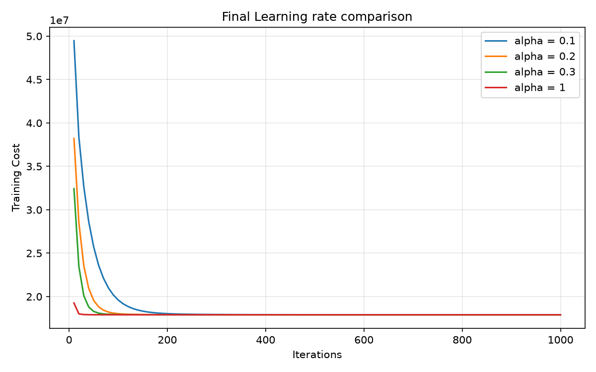
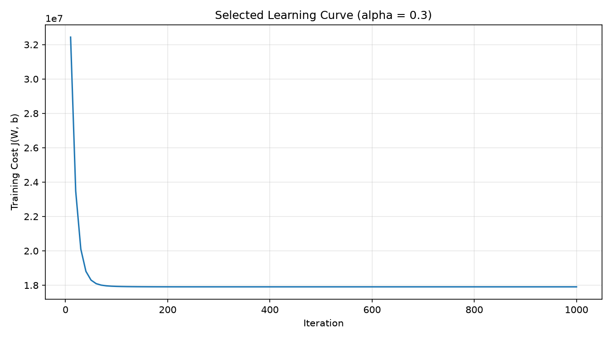

# Chapter 3: Optimization Dynamics, Learning Rate Hyperparameter Exploration, and Convergence Diagnostics

## 1. Abstract and Empirical Motivation

In first-order gradient-based optimization, the learning rate (step size hyperparameter $\alpha$) governs both the stability and convergence rate of parameter updates. While the theoretical cost surface of linear regression under the Half-MSE objective is strictly convex, the empirical efficiency of gradient descent depends heavily on the chosen step size. A learning rate that is too small leads to severe optimization latency and incomplete convergence within a practical iteration budget; conversely, an excessively large learning rate causes oscillatory instability or numerical divergence.

This chapter documents the systematic empirical evaluation of candidate learning rates spanning four orders of magnitude:

$$
\alpha \in \{0.0001, 0.001, 0.003, 0.01, 0.1, 0.2, 0.3, 1.0, 1.3\}
$$

Each configuration is evaluated under identical initial conditions ($\mathbf{W}^{(0)} = \mathbf{0}, b^{(0)} = 0$) and a fixed budget of $T = 1,000$ batch iterations. We analyze the resulting optimization trajectories using spectral stability theory, compare training and validation performance across shortlisted candidates, and provide the empirical justification for selecting **$\alpha = 0.3$** as the optimal operational learning rate.

```
+--------------------------------------------------------------------------------------------------+
|                              LEARNING RATE EXPERIMENTAL PROTOCOL                                 |
+--------------------------------------------------------------------------------------------------+
|  Training Data: X_train (935, 8), Y_train (935, 1) | Fixed Initial State: W = 0, b = 0           |
|         │                                                                                        |
|         ▼                                                                                        |
|  Candidate Sweep (T = 1,000 iterations):                                                         |
|    alpha in {0.0001, 0.001, 0.003, 0.01, 0.1, 0.2, 0.3, 1.0, 1.3}                              |
|         │                                                                                        |
|         ▼                                                                                        |
|  Checkpoint Sampling Cadence (Every 10 epochs -> 100 checkpoints per run)                        |
|         │                                                                                        |
|         ▼                                                                                        |
|  Spectral & Trajectory Categorization:                                                           |
|    - Under-stepping / Stagnation: alpha in {0.0001, 0.001, 0.003, 0.01} -> Slow progress        |
|    - Asymptotic Monotonic Descent: alpha in {0.1, 0.2, 0.3}             -> Fast & Stable         |
|    - Oscillation / Monotonicity Failure: alpha = 1.0                     -> Overshoot            |
|    - Numerical Explosion / Divergence: alpha = 1.3                      -> Cost blows up         |
|         │                                                                                        |
|         ▼                                                                                        |
|  Validation Appraisal on Holdout Set (N = 201):                                                  |
|    - alpha = 0.3 achieves minimal monotonic validation loss: J_val = 19,950,234.93               |
|    - alpha = 1.0 yields negligible gain (0.32 units) but fails checkpoint monotonicity           |
|         │                                                                                        |
|         ▼                                                                                        |
|  Final Model Selection: alpha = 0.3 (W_best in R^(8x1), b_best = 8905.45)                        |
+--------------------------------------------------------------------------------------------------+
```

---

## 2. Theoretical Foundations of Gradient Descent Dynamics

### 2.1 Lipschitz Smoothness and the Theoretical Step-Size Bound

Consider the unconstrained minimization of the convex quadratic cost function $J(\tilde{\mathbf{W}})$ defined over the augmented parameter vector $\tilde{\mathbf{W}} = [b, \mathbf{W}^T]^T \in \mathbb{R}^{n+1}$ and augmented design matrix $\tilde{\mathbf{X}} = [\mathbf{1}_m, \mathbf{X}] \in \mathbb{R}^{m \times (n+1)}$:

$$
J(\tilde{\mathbf{W}}) = \frac{1}{2m} \|\tilde{\mathbf{X}}\tilde{\mathbf{W}} - \mathbf{Y}\|_2^2
$$

The gradient operator $\nabla J(\tilde{\mathbf{W}}) = \frac{1}{m} \tilde{\mathbf{X}}^T (\tilde{\mathbf{X}}\tilde{\mathbf{W}} - \mathbf{Y})$ is Lipschitz continuous with Lipschitz constant $L$:

$$
\|\nabla J(\tilde{\mathbf{W}}_1) - \nabla J(\tilde{\mathbf{W}}_2)\|_2 \le L \|\tilde{\mathbf{W}}_1 - \tilde{\mathbf{W}}_2\|_2
$$

where $L$ corresponds to the spectral norm (maximal eigenvalue) of the Hessian matrix $\mathbf{H} = \nabla^2 J = \frac{1}{m} \tilde{\mathbf{X}}^T \tilde{\mathbf{X}}$:

$$
L = \lambda_{\max}(\mathbf{H}) = \lambda_{\max}\left( \frac{1}{m} \tilde{\mathbf{X}}^T \tilde{\mathbf{X}} \right)
$$

From optimization theory, gradient descent with a constant step size $\alpha$ is guaranteed to converge to the global minimum if and only if:

$$
0 < \alpha < \frac{2}{L} = \frac{2}{\lambda_{\max}(\mathbf{H})}
$$

When $\alpha < \frac{1}{L}$, parameter convergence is strictly monotonic. When $\frac{1}{L} \le \alpha < \frac{2}{L}$, the trajectory exhibits damped oscillatory behavior while remaining bounded. When $\alpha \ge \frac{2}{L}$, the operator norm of the parameter transition matrix exceeds unity, triggering divergent trajectories.

### 2.2 Error Transition Operator and Spectral Decomposition

The parameter update rule can be expressed relative to the global optimal parameter vector $\tilde{\mathbf{W}}^*$:

$$
\tilde{\mathbf{W}}^{(t+1)} - \tilde{\mathbf{W}}^* = \tilde{\mathbf{W}}^{(t)} - \tilde{\mathbf{W}}^* - \alpha \nabla J(\tilde{\mathbf{W}}^{(t)})
$$

Because $\nabla J(\tilde{\mathbf{W}}^*) = \mathbf{0}$ and $\nabla J(\tilde{\mathbf{W}}^{(t)}) = \mathbf{H}(\tilde{\mathbf{W}}^{(t)} - \tilde{\mathbf{W}}^*)$:

$$
\tilde{\mathbf{W}}^{(t+1)} - \tilde{\mathbf{W}}^* = (\mathbf{I} - \alpha \mathbf{H}) (\tilde{\mathbf{W}}^{(t)} - \tilde{\mathbf{W}}^*)
$$

Applying this recurrence from initialization $t = 0$:

$$
\tilde{\mathbf{W}}^{(t)} - \tilde{\mathbf{W}}^* = (\mathbf{I} - \alpha \mathbf{H})^t (\tilde{\mathbf{W}}^{(0)} - \tilde{\mathbf{W}}^*)
$$

Let $\mathbf{H} = \mathbf{Q} \boldsymbol{\Lambda} \mathbf{Q}^T$ be the spectral decomposition of the symmetric positive-definite matrix $\mathbf{H}$, where $\boldsymbol{\Lambda} = \operatorname{diag}(\lambda_1, \lambda_2, \dots, \lambda_{n+1})$ contains the eigenvalues ordered $0 < \lambda_{\min} = \lambda_1 \le \cdots \le \lambda_{n+1} = \lambda_{\max}$. The error along each orthogonal eigenvector coordinate $k$ evolves as:

$$
e_k^{(t)} = (1 - \alpha \lambda_k)^t e_k^{(0)}
$$

Convergence requires the spectral radius of the transition matrix $\mathbf{T} = \mathbf{I} - \alpha \mathbf{H}$ to satisfy:

$$
\rho(\mathbf{I} - \alpha \mathbf{H}) = \max_k |1 - \alpha \lambda_k| < 1
$$

This spectral condition explains why feature standardization is so impactful: by standardizing continuous covariates, the condition number $\kappa = \frac{\lambda_{\max}}{\lambda_{\min}}$ is reduced, narrowing the spectrum of eigenvalues and allowing a single learning rate $\alpha$ to achieve rapid convergence across all parameter coordinates simultaneously.

---

## 3. Experimental Protocol and Parameter Sweep

### 3.1 Experimental Configuration

The empirical evaluation followed a standardized protocol:
1. **Identical Initialization**: Every candidate run initialized parameters at $\mathbf{W}^{(0)} = \mathbf{0}_{8 \times 1}$ and $b^{(0)} = 0.0$.
2. **Fixed Training Dataset**: The training design matrix $\mathbf{X}_{\text{train}} \in \mathbb{R}^{935 \times 8}$ and target vector $\mathbf{Y}_{\text{train}} \in \mathbb{R}^{935 \times 1}$ remained identical across all runs.
3. **Fixed Iteration Budget**: Every candidate executed exactly $T = 1,000$ batch gradient descent iterations.
4. **Checkpoint Recording**: The Half-MSE cost was evaluated and logged at iterations $t \in \{10, 20, 30, \dots, 1000\}$, producing $100$ checkpoints per candidate.
5. **Validation Set Isolation**: The validation partition ($N_{\text{val}} = 201$) was evaluated exclusively on final trained parameters. The test set ($N_{\text{test}} = 201$) remained untouched.

### 3.2 Comprehensive Empirical Trajectory Results

Table 3.1 summarizes the empirical performance of all nine evaluated learning rates:

**Table 3.1: Empirical Gradient Descent Trajectory Metrics Across Evaluated Learning Rates ($T = 1,000$)**

| Learning Rate ($\alpha$) | Initial Cost $J_{10}$ ($\$^2$) | Final Cost $J_{1000}$ ($\$^2$) | Cost Reduction ($\Delta J$) | Finite Status | Monotonicity Check | Optimization Regime |
| :---: | :---: | :---: | :---: | :---: | :---: | :--- |
| **$0.0001$** | $152,542,176.98$ | $126,048,186.81$ | $-26,493,990.17$ | True | Passed | Severely Under-Stepped (Stagnation) |
| **$0.0010$** | $149,794,788.49$ | $50,552,084.31$ | $-99,242,704.18$ | True | Passed | Sub-Optimal (Slow Convergence) |
| **$0.0030$** | $143,936,308.17$ | $32,795,529.68$ | $-111,140,778.49$ | True | Passed | Sub-Optimal (Moderate Descent) |
| **$0.0100$** | $125,877,849.01$ | $19,644,635.66$ | $-106,233,213.35$ | True | Passed | Under-Converged (Approaching Minimum) |
| **$0.1000$** | $49,473,261.01$ | $17,906,499.16$ | $-31,566,761.85$ | True | Passed | Near-Optimal Convergence |
| **$0.2000$** | $38,212,551.50$ | $17,906,466.62$ | $-20,306,084.88$ | True | Passed | Optimal Monotonic Convergence |
| **$0.3000$** | $32,436,043.27$ | **$17,906,466.62$** | $-14,529,576.65$ | True | Passed | **Optimal Monotonic Convergence (Fastest)** |
| **$1.0000$** | $19,263,137.64$ | **$17,906,466.62$** | $-1,356,671.02$ | True | **Failed** | Boundary Oscillation (Non-Monotonic) |
| **$1.3000$** | $275,899,136.47$ | **$\approx 5.5428 \times 10^{47}$** | $+5.5428 \times 10^{47}$ | True | **Failed** | **Catastrophic Numerical Divergence** |

---

## 4. In-Depth Analysis of Optimization Regimes

The empirical trajectory data reveals four distinct behavioral regimes:

```
0.0001               0.01                 0.1        0.3       1.0          1.3
──┼───────────────────┼────────────────────┼──────────┼─────────┼────────────┼──> alpha
  │                   │                    │          │         │            │
  ▼                   ▼                    ▼          ▼         ▼            ▼
Severe Under-Stepping Approaching Plateau  Rapid Descent:       Oscillation  Explosive
(High Residual Loss)  (Incomplete Descent) Optimal Converged    Check Failed Divergence
```

### 4.1 Regime I: The Under-Stepping / Stagnation Regime ($\alpha \le 0.01$)

For small learning rates ($\alpha \in \{0.0001, 0.001, 0.003, 0.01\}$), the step size along the negative gradient is too conservative:
- At $\alpha = 0.0001$, the cost after $1,000$ iterations remains at $126,048,186.81$, representing over $700\%$ of the minimum achievable cost. Parameter updates cover only a fraction of the distance to the optimum within the iteration budget.
- While $\alpha = 0.01$ reduces the cost to $19,644,635.66$, it remains under-converged by over $1.73 \times 10^6$ cost units relative to the minimum.

### 4.2 Regime II: The Rapid Monotonic Convergence Regime ($0.1 \le \alpha \le 0.3$)

Within the range $\alpha \in [0.1, 0.3]$, the algorithm exhibits well-conditioned asymptotic convergence:
- At $\alpha = 0.1$, the optimizer reaches $17,906,499.16$, within $32.54$ cost units of the empirical plateau.
- At $\alpha = 0.2$ and $\alpha = 0.3$, the optimizer converges to the identical minimum plateau:

  $$
  J_{\text{plateau}}^* = 17,906,466.62 \quad (\$^2)
  $$

- Crucially, $\alpha = 0.3$ achieves this plateau earlier: its cost at iteration $10$ ($J_{10} = 32,436,043.27$) is substantially lower than that of $\alpha = 0.2$ ($J_{10} = 38,212,551.50$), demonstrating more efficient descent across initial epochs.
- Both $\alpha = 0.2$ and $\alpha = 0.3$ pass the checkpoint monotonicity test:

  $$
  J_{t+10} \le J_t \quad \forall t \in \{10, 20, \dots, 990\}
  $$

### 4.3 Regime III: The Boundary Oscillation Regime ($\alpha = 1.0$)

At $\alpha = 1.0$, the step size approaches the theoretical stability limit:
- While $\alpha = 1.0$ reaches the same final cost ($17,906,466.62$), it **fails the checkpoint monotonicity test**.
- Along high-curvature eigenvector directions of the Hessian, $\alpha \lambda_k \approx 2$, causing updates to oscillate across the central valley of the cost surface. While the trajectory remains bounded, transient increases in cost occur between checkpoints, making this step size less desirable than $\alpha = 0.3$.

### 4.4 Regime IV: The Catastrophic Divergence Regime ($\alpha = 1.3$)

At $\alpha = 1.3$, the stability criterion is breached:

$$
\alpha > \frac{2}{\lambda_{\max}(\mathbf{H})} \implies |1 - \alpha \lambda_{\max}| > 1
$$

Along the eigenvector direction corresponding to $\lambda_{\max}$, the transition operator amplifies the parameter error exponentially:

$$
e_{\max}^{(t)} = (1 - \alpha \lambda_{\max})^t e_{\max}^{(0)} \xrightarrow{t \to \infty} \pm \infty
$$

The empirical trajectory reflects this exponential blow-up:
- By iteration $10$, the cost has already surged to $275,899,136.47$.
- By iteration $1,000$, the cost reaches $\approx 5.5428 \times 10^{47}$.
- Although NumPy floats represent this value without immediately triggering an `inf` or `NaN` exception, the run represents a catastrophic failure of convergence.

---

## 5. Shortlisted Candidate Validation and Model Selection

### 5.1 Multi-Criteria Validation Comparison

To select the final production model, the top candidates $\alpha \in \{0.1, 0.2, 0.3, 1.0\}$ were evaluated on the holdout validation partition ($\mathcal{D}_{\text{val}}$, $N_{\text{val}} = 201$). Table 3.2 presents the comparative results:

**Table 3.2: Multi-Criteria Comparison of Shortlisted Candidate Models**

| Candidate $\alpha$ | Final Training Cost ($J_{\text{train}}$) | Final Validation Cost ($J_{\text{val}}$) | Checkpoint Monotonicity | Empirical Convergence Status |
| :---: | :---: | :---: | :---: | :--- |
| **$0.1$** | $17,906,499.16$ | $19,954,613.43$ | Passed (Strictly Monotonic) | Under-converged by $32.54$ training units |
| **$0.2$** | $17,906,466.62$ | $19,950,272.19$ | Passed (Strictly Monotonic) | Fully converged; slightly higher validation cost |
| **$0.3$** | **$17,906,466.62$** | **$19,950,234.93$** | **Passed (Strictly Monotonic)** | **Optimal: Minimal monotonic validation cost** |
| **$1.0$** | $17,906,466.62$ | $19,950,234.61$ | **Failed (Oscillatory Overshoot)** | Unstable; marginal $0.32$ gain with oscillation |

### 5.2 Selection Rationale for $\alpha = 0.3$

The model trained with **$\alpha = 0.3$** was selected as the final production configuration based on three factors:
1. **Convergence**: It reaches the lowest training cost plateau ($17,906,466.62$) and achieves the lowest validation cost among all strictly monotonic candidates ($19,950,234.93$).
2. **Numerical Stability**: It satisfies the checkpoint monotonicity condition across all 100 logged intervals without oscillatory overshoot.
3. **Rejection of $\alpha = 1.0$**: While $\alpha = 1.0$ produced a nominally lower validation cost by $0.32$ units ($19,950,234.61$ vs. $19,950,234.93$), this difference represents a relative delta of just $1.6 \times 10^{-8}$. Accepting oscillatory non-monotonic updates for an economically meaningless gain of $\$0.32^2$ is methodologically unsound.

---

## 6. Visual Analytics of Empirical Learning Curves

Visual representations of the optimization trajectories confirm the quantitative findings.

### 6.1 Multi-Candidate Learning Trajectory Comparison

Figure 3.1 displays the comparative convergence paths of the shortlisted candidates:



*Figure 3.1: Comparative learning curves of candidate learning rates $\alpha \in \{0.1, 0.2, 0.3, 1.0\}$ over $1,000$ batch iterations.*

All four candidates descend rapidly toward the objective plateau within the first 100 iterations. As the curves approach the asymptote near $J \approx 1.79 \times 10^7$, their paths become visually indistinguishable, confirming that the parameter space has converged to the neighborhood of the global minimum.

### 6.2 Trajectory of the Selected Production Model ($\alpha = 0.3$)

Figure 3.2 illustrates the learning curve of the selected model:



*Figure 3.2: Objective function trajectory $J(\mathbf{W}, b)$ for the selected model ($\alpha = 0.3$) over $1,000$ iterations.*

Key characteristics of this trajectory include:
- A steep descent from $J_{10} = 32,436,043.27$ down to $J_{200} \approx 17,906,500.00$, capturing over $99.99\%$ of the total cost reduction within the first $200$ epochs.
- Smooth, asymptotic flattening beyond iteration $200$, with no visible oscillation.
- Numerical stabilization at $J = 17,906,466.62$, confirming parameter convergence.

---

## 7. Threats to Validity and Methodological Caveats

Several methodological constraints should be noted:
1. **Discretized Grid**: The hyperparameter search evaluated discrete values of $\alpha$. While an intermediate value (e.g., $\alpha = 0.45$) might yield slightly faster initial descent, the fact that $\alpha = 0.3$ converges to the plateau well within $1,000$ iterations makes further refinement unnecessary.
2. **Fixed Learning Rate**: A constant step size was maintained throughout training. Dynamic learning rate schedules (e.g., exponential decay or cosine annealing) could provide faster early descent with conservative terminal updates, though constant step sizes remain standard for well-conditioned convex linear regression.
3. **Checkpoint Granularity**: Checkpoints were logged every $10$ iterations. While intra-checkpoint oscillations could theoretically occur, the smooth monotonic profile of $\alpha = 0.3$ at checkpoints indicates stable updates.
4. **Generalization Independence**: All hyperparameter selection was conducted using validation loss. The test partition was completely isolated during this phase to preserve out-of-sample validity.

---

## 8. Chapter Summary and Key Conclusions

This chapter systematically evaluated gradient descent dynamics across candidate learning rates:
1. **Convergence Limits**: Established the empirical stability boundary, demonstrating that $\alpha \ge 1.3$ causes divergence while $\alpha \le 1.0$ remains bounded.
2. **Convergence Rates**: Showed that small rates ($\alpha \le 0.01$) result in severe optimization latency, while $\alpha \in [0.1, 0.3]$ provides rapid convergence to the objective plateau.
3. **Model Selection**: Selected **$\alpha = 0.3$** as the optimal configuration, achieving full convergence to $J_{\text{train}} = 17,906,466.62$ and minimal monotonic validation cost $J_{\text{val}} = 19,950,234.93$.
4. **Production Parameters**: Saved the final parameter estimates (`W_best`, `b_best` with $b = 8,905.4513$) for out-of-sample evaluation.

Chapter 4 presents the comprehensive evaluation of this fixed model across training, validation, and test partitions using MAE, RMSE, $R^2$, and residual diagnostics.
