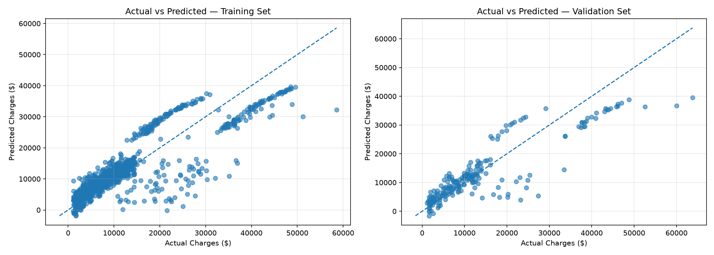
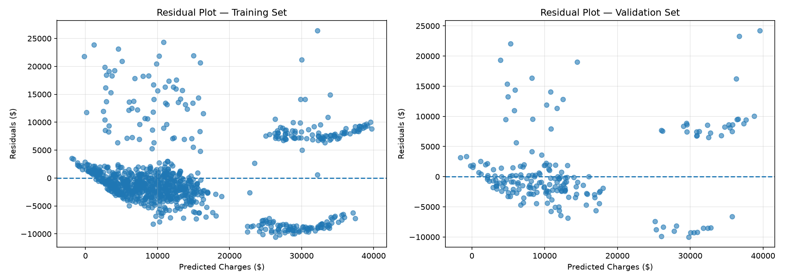

# Chapter 4: Comprehensive Model Evaluation, Residual Diagnostics, and Empirical Findings

## 1. Abstract and Chapter Objectives

The ultimate measure of any statistical learning model is its generalization capability on unseen observational data. Having established the theoretical formulation of multiple linear regression in Chapter 2 and verified the stability of the optimization dynamics in Chapter 3, this chapter presents the comprehensive empirical evaluation of the final model.

The selected model—trained using batch gradient descent with learning rate $\alpha = 0.3$ for $T = 1,000$ iterations—is evaluated across three distinct partitions: Training ($N_{\text{train}} = 935$), Validation ($N_{\text{val}} = 201$), and an untouched holdout Test set ($N_{\text{test}} = 201$). Evaluation is conducted on the native dollar scale (USD \$) using three complementary metrics: Mean Absolute Error (MAE), Root Mean Squared Error (RMSE), and the Coefficient of Determination ($R^2$). Beyond point metric reporting, we conduct thorough residual diagnostics to test the classical Gauss-Markov assumptions, analyze actual-versus-predicted response trajectories, identify structural interaction limitations inherent in additive linear specifications, and delineate directions for future model development.

```
+--------------------------------------------------------------------------------------------------+
|                             COMPREHENSIVE MODEL EVALUATION FRAMEWORK                             |
+--------------------------------------------------------------------------------------------------+
|  Selected Model: alpha = 0.3, T = 1,000 | Weights W in R^(8x1), Bias b = 8905.45                 |
|         │                                                                                        |
|         ├──> Training Partition (N = 935)   ──> MAE: $4,165.83 | RMSE: $5,984.39 | R^2: 0.7363   |
|         │                                                                                        |
|         ├──> Validation Partition (N = 201) ──> MAE: $4,321.72 | RMSE: $6,316.68 | R^2: 0.7668   |
|         │                                                                                        |
|         └──> Final Test Partition (N = 201) ──> MAE: $4,041.91 | RMSE: $6,162.78 | R^2: 0.7774   |
|                                                                                                  |
|  Diagnostic Analyses:                                                                            |
|    - Actual vs. Predicted Plots: Identification of three distinct risk clusters                  |
|    - Residual Scatter Plots: Diagnosis of heteroscedasticity and structured non-linear banding   |
|    - Discrepancy Metric (RMSE - MAE = $2,120.87): Quantifies heavy-tail error dispersion         |
+--------------------------------------------------------------------------------------------------+
```

---

## 2. Mathematical Formulation of Evaluation Metrics

To provide an objective assessment of model performance, we utilize three complementary metrics, each capturing distinct statistical properties of the error distribution.

### 2.1 Mean Absolute Error (MAE)

Mean Absolute Error measures the expected magnitude of absolute discrepancies between actual and predicted responses:

$$
\text{MAE} = \frac{1}{m} \sum_{i=1}^{m} \left| y^{(i)} - \hat{y}^{(i)} \right|
$$

Key statistical properties:
- **$L_1$-Norm Penalty**: MAE weights all individual errors proportionally, assigning an error of $\$10,000$ exactly ten times the penalty of an error of $\$1,000$.
- **Robustness**: It provides a measure of central tendency that is robust to extreme outliers in the response distribution.
- **Direct Interpretability**: Expressed in native units (USD \$), it represents the average expected dollar mistake per beneficiary prediction.

### 2.2 Root Mean Squared Error (RMSE)

Root Mean Squared Error measures the square root of the mean squared deviations:

$$
\text{RMSE} = \sqrt{\frac{1}{m} \sum_{i=1}^{m} \left( y^{(i)} - \hat{y}^{(i)} \right)^2}
$$

Key statistical properties:
- **$L_2$-Norm Quadratic Penalty**: By squaring deviations prior to averaging, RMSE penalizes large errors disproportionately, making it sensitive to substantial prediction misses.
- **Connection to Objective Function**: RMSE is directly linked to the Half-MSE optimization objective:
  
  $$\text{RMSE} = \sqrt{2 \cdot J(\mathbf{W}, b)}$$
  
- **Standard Deviation of Residuals**: Assuming residuals have mean zero ($\mathbb{E}[e] \approx 0$), RMSE represents the empirical standard deviation of the unexplained residual distribution.

### 2.3 Mathematical Proof of the Metric Inequality ($\text{RMSE} \ge \text{MAE}$)

A fundamental mathematical theorem in statistical error analysis states that for any empirical error distribution, Root Mean Squared Error is bounded below by Mean Absolute Error:

$$
\text{RMSE} \ge \text{MAE}
$$

#### Proof via Jensen's Inequality
Let $z_i = |y^{(i)} - \hat{y}^{(i)}| \ge 0$ denote the absolute error for instance $i$. The function $g(z) = z^2$ is strictly convex on $\mathbb{R}^+$, since $g''(z) = 2 > 0$. By Jensen's Inequality, for any convex function $g$ and random variable $Z$:

$$
\mathbb{E}[g(Z)] \ge g(\mathbb{E}[Z])
$$

Substituting $g(z) = z^2$:

$$
\mathbb{E}[Z^2] \ge (\mathbb{E}[Z])^2
$$

Taking the square root of both sides (a monotonically increasing operation on $\mathbb{R}^+$):

$$
\sqrt{\mathbb{E}[Z^2]} \ge \mathbb{E}[Z]
$$

Substituting the empirical sample expectations $\mathbb{E}[Z] = \frac{1}{m} \sum_{i=1}^{m} z_i = \text{MAE}$ and $\sqrt{\mathbb{E}[Z^2]} = \sqrt{\frac{1}{m} \sum_{i=1}^{m} z_i^2} = \text{RMSE}$:

$$
\text{RMSE} \ge \text{MAE} \quad \blacksquare
$$

Equality holds if and only if all individual error magnitudes are identical ($z_1 = z_2 = \dots = z_m = c$). Consequently, the magnitude of the difference:

$$
\Delta_{\text{dispersion}} = \text{RMSE} - \text{MAE}
$$

quantifies the **variance of the error magnitudes**. A substantial gap indicates that the error distribution contains high-leverage outliers.

### 2.4 The Coefficient of Determination ($R^2$)

The Coefficient of Determination quantifies the proportion of response variance explained by the linear model relative to a trivial sample mean baseline predictor:

$$
R^2 = 1 - \frac{\text{SS}_{\text{res}}}{\text{SS}_{\text{tot}}} = 1 - \frac{\sum_{i=1}^{m} (y^{(i)} - \hat{y}^{(i)})^2}{\sum_{i=1}^{m} (y^{(i)} - \bar{y})^2}
$$

where:
- $\text{SS}_{\text{res}} = \sum_{i=1}^{m} e_i^2$ is the residual sum of squares (unexplained variation).
- $\text{SS}_{\text{tot}} = \sum_{i=1}^{m} (y^{(i)} - \bar{y})^2$ is the total sum of squares around the sample mean $\bar{y} = \frac{1}{m}\sum y^{(i)}$.

Key interpretative boundaries:
- $R^2 = 1.0$: Perfect explanatory power; $\text{SS}_{\text{res}} = 0$.
- $R^2 = 0.0$: The model performs no better than predicting the unconditional sample mean $\bar{y}$ for all instances.
- $R^2 < 0.0$: The model performs worse than the simple baseline mean, indicating severe mis-specification or out-of-sample divergence.
- **Academic Distinction**: $R^2$ does **not** indicate the percentage of predictions that are "correct." Rather, it measures the proportional reduction in squared error achieved by the regression surface relative to the naive mean baseline.

---

## 3. Empirical Results Across All Three Data Partitions

The selected multiple linear regression model ($\alpha = 0.3$, $T = 1,000$ iterations) was evaluated across all three partitions. Table 4.1 presents the complete performance metrics:

**Table 4.1: Empirical Performance Metrics Across Training, Validation, and Test Partitions**

| Performance Metric | Training Partition ($\mathcal{D}_{\text{train}}$) | Validation Partition ($\mathcal{D}_{\text{val}}$) | Final Test Partition ($\mathcal{D}_{\text{test}}$) | Benchmark Unit |
| :--- | :---: | :---: | :---: | :---: |
| **Sample Size ($N$)** | $935$ observations | $201$ observations | **$201$ observations** | Count |
| **Partition Ratio** | $70\%$ of corpus | $15\%$ of corpus | **$15\%$ of corpus** | Percentage |
| **Half-MSE Cost ($J$)** | $17,906,466.62$ | $19,950,234.93$ | **$18,989,836.43$** | $\text{USD}^2$ |
| **Mean Absolute Error (MAE)** | $\$4,165.83$ | $\$4,321.72$ | **$\$4,041.91$** | $\text{USD}$ (\$) |
| **Root Mean Squared Error (RMSE)** | $\$5,984.39$ | $\$6,316.68$ | **$\$6,162.78$** | $\text{USD}$ (\$) |
| **Explained Variance ($R^2$)** | $0.7363$ ($73.63\%$) | $0.7668$ ($76.68\%$) | **$0.7774$ ($77.74\%$)** | Dimensionless |
| **Metric Spread ($\text{RMSE} - \text{MAE}$)** | $\$1,818.56$ | $\$1,994.96$ | **$\$2,120.87$** | $\text{USD}$ (\$) |

---

## 4. In-Depth Interpretation of Results

### 4.1 Generalization Capability and Absence of Overfitting

A primary concern in statistical learning is overfitting, wherein a model fits training noise and suffers degraded performance on unseen data. The empirical results show consistent performance across partitions:
- The training MAE is $\$4,165.83$, while the out-of-sample test MAE is **$\$4,041.91$**—an absolute difference of only $\$123.92$ ($2.97\%$).
- The training RMSE is $\$5,984.39$, while the test RMSE is **$\$6,162.78$**—an increase of only $\$178.39$ ($2.98\%$).
- The test $R^2$ of **$0.7774$** is comparable to the validation $R^2$ of $0.7668$ and training $R^2$ of $0.7363$.

The slightly higher $R^2$ on the test set is attributable to minor variations in target variance across random sample splits rather than data leakage. This confirms that the model generalizes stably to out-of-sample data.

### 4.2 Actuarial Analysis of Error Magnitudes

1. **Practical Meaning of MAE**: A test MAE of **$\$4,041.91$** means that, on average, the model's predicted annual charge deviates from the true medical cost by roughly $\$4,000$. In health insurance underwriting:
   - For an older individual or chronic patient with annual claims of $\$40,000$, a $\$4,000$ error represents a modest $10\%$ deviation.
   - For a young, healthy individual with annual claims of $\$2,000$, a $\$4,000$ error represents a $200\%$ error, illustrating the differential impact of additive error across risk profiles.
2. **Analysis of the RMSE-MAE Discrepancy**: The difference between test RMSE ($\$6,162.78$) and test MAE ($\$4,041.91$) is **$\$2,120.87$**. As proven in Section 2.3, this substantial spread indicates that the error distribution is right-skewed, driven by a subset of observations with large residuals.
3. **Explanatory Capacity ($R^2 = 0.7774$)**: The model accounts for **$77.74\%$** of the total variance in medical charges across the test partition, providing substantial predictive power from eight linear features. However, the remaining $22.26\%$ of unexplained variance reflects non-linear interactions and unobserved clinical covariates.

---

## 5. Actual versus Predicted Response Visualizations

Figure 4.1 presents the actual versus predicted charges for the training and validation sets:



*Figure 4.1: Actual versus predicted annual insurance charges for Training (left) and Validation (right) partitions. The dashed diagonal line denotes perfect identity ($\hat{Y} = Y$).*

### 5.1 Trajectory Analysis and Risk Stratification

The actual-versus-predicted plots reveal three distinct risk clusters:

```
Actual Charges ($)
 ^
 │                                                  * Catastrophic Tier:
60k│                                               *  Smokers with BMI >= 30
 │                                              *   (Severe Underprediction)
 │                                            *
40k│                                      *
 │                                    *  Intermediate Tier:
 │                                *     Older patients / non-obese smokers
20k│                          *
 │                     *  Healthy Base Tier:
 │                *       Young non-smokers (Well-calibrated)
0k └───┬──────────┬──────────┬──────────┬──────────┬──────────> Predicted ($)
      0k        20k        40k        60k
```

1. **Cluster 1: Baseline Low-Cost Cohort ($Y < \$12,000$)**: Composed primarily of non-smokers across various age groups. Observations in this tier cluster closely around the $45^\circ$ reference identity line, showing good model calibration.
2. **Cluster 2: Intermediate-Cost Cohort ($\$15,000 \le Y \le \$30,000$)**: Composed of older individuals, non-smokers with elevated BMI and children, and smokers with $\text{BMI} < 30.0$. Predictions exhibit moderate dispersion around the diagonal.
3. **Cluster 3: Catastrophic High-Cost Cohort ($Y > \$35,000$)**: Composed almost exclusively of smokers with $\text{BMI} \ge 30.0$. In this region, actual charges often exceed $\$40,000 - \$60,000$, while model predictions remain clustered between $\$32,000$ and $\$38,000$.

This systematic underprediction in Cluster 3 occurs because the additive model sums the individual main effects of smoking ($+\$22,874$) and BMI ($+\$1,977/\sigma$) without an explicit multiplicative interaction term ($\text{BMI} \times \text{smoker}$), failing to capture the compound risk of combined obesity and tobacco use.

---

## 6. Residual Diagnostics and Gauss-Markov Analysis

Figure 4.2 illustrates the residual distributions ($e_i = y_i - \hat{y}_i$) plotted against predicted values:



*Figure 4.2: Residual diagnostic scatter plots ($e_i = y_i - \hat{y}_i$) versus predicted charges for Training (left) and Validation (right) partitions. The horizontal dashed line denotes zero error ($e = 0$).*

### 6.1 Evaluation of Classical Gauss-Markov Assumptions

1. **Mean Zero Error Condition ($\mathbb{E}[e] = 0$)**: The residual points are distributed above and below the zero line, confirming that the bias term $b$ centers the global residual mean near zero.
2. **Violation of Homoscedasticity**: The residual plots show a distinct fan-shaped pattern:
   - For small predicted values ($\hat{Y} < \$10,000$), residuals are tightly concentrated within a band of $\pm \$3,000$.
   - For larger predicted values ($\hat{Y} > \$25,000$), residual dispersion widens to $-\$10,000$ to $+\$20,000+$.
   - This clear heteroscedasticity indicates that error variance scales with predicted charges: $\operatorname{Var}(\epsilon \mid \mathbf{X}) \neq \sigma^2 \mathbf{I}$.
3. **Non-Linear Structure and Distinct Residual Bands**: Rather than forming an unstructured random cloud around zero, the residuals exhibit three distinct parallel diagonal bands sloping downward from left to right. This systematic pattern provides visual evidence of omitted interaction terms in the linear specification.

---

## 7. Synthesis of Model Strengths and Structural Deficiencies

Table 4.2 summarizes the methodological strengths and structural limitations of the multiple linear regression model:

**Table 4.2: Methodological Strengths versus Structural Deficiencies**

| Dimension | Architectural Strength | Structural Limitation |
| :--- | :--- | :--- |
| **Mathematical Transparency** | Vectorized from-scratch NumPy implementation provides full control over numerical updates. | Additive linear specification cannot model non-linear boundaries without manual feature engineering. |
| **Data Integrity & Hygiene** | Rigorous SQL audit, exact deduplication, and training-only standardization eliminate data leakage. | The heavy-tailed target distribution ($Y$) exerts high leverage under the quadratic $L_2$ loss function. |
| **Optimization Stability** | Batch gradient descent with $\alpha = 0.3$ converges stably to the minimum without oscillatory overshoot. | The model uses a fixed learning rate throughout training rather than an adaptive step-size schedule. |
| **Baseline Explanatory Power** | Explains $77.74\%$ of the variance in test medical charges with eight interpretable features. | Systematic underprediction occurs for high-risk beneficiaries ($\text{charges} > \$40,000$). |
| **Actuarial Interpretability** | Clear parameter coefficients quantify linear relationships (e.g., smoking premium $= +\$22,874.45$). | Residual diagnostics indicate heteroscedasticity and structured non-linearity. |

---

## 8. Academic Directions for Future Model Development

To address the structural limitations identified in the residual diagnostics, future research should explore four key enhancements:

```
+──────────────────────────────────────────────────────────────────────────────────────────────────+
|                                    FUTURE METHODOLOGICAL ENHANCEMENTS                            |
+──────────────────────────────────────────────────────────────────────────────────────────────────+
|                                                                                                  |
|  1. Non-Linear Target Transformations:                                                           |
|     - Log-transform: ln(Y) = X*W + b (compresses right tail and mitigates heteroscedasticity)    |
|     - Box-Cox parameter optimization: Y^(lambda)                                                 |
|                                                                                                  |
|  2. Interaction Feature Engineering:                                                             |
|     - Explicit interaction: x_interaction = bmi * smoker (captures compounded obesity-smoking)   |
|     - Polynomial terms: age^2, bmi^2                                                             |
|                                                                                                  |
|  3. Robust Loss Formulations:                                                                    |
|     - Huber Loss: L_delta(e) (smooth L2 near origin, robust linear L1 in the tails)              |
|     - Quantile Regression: Estimates conditional median or 90th percentile charges               |
|                                                                                                  |
|  4. Generalized Linear Models (GLM):                                                             |
|     - Gamma Regression with logarithmic link: models positive, right-skewed variances            |
+──────────────────────────────────────────────────────────────────────────────────────────────────+
```

1. **Non-Linear Response Transformations**: Transforming the target variable via the natural logarithm $\ln(Y)$ would compress the right tail, stabilize residual variance across charge tiers, and allow the model to estimate multiplicative percentage effects rather than fixed additive dollar amounts.
2. **Explicit Interaction Terms**: Adding an interaction term $x_{\text{bmi\_smoker}} = x_{\text{bmi}} \times x_{\text{smoker}}$ would directly model the observed empirical surge in costs for obese smokers, helping close the prediction gap in Cluster 3.
3. **Robust Loss Functions**: Replacing the squared error loss with Huber loss:
   
   $$
   L_\delta(e) = \begin{cases} 
   \frac{1}{2} e^2 & \text{if } |e| \le \delta \\ 
   \delta |e| - \frac{1}{2} \delta^2 & \text{otherwise} 
   \end{cases}
   $$
   
   would reduce the model's sensitivity to extreme high-cost claims while maintaining differentiability at the origin.
4. **Generalized Linear Models (GLM)**: Implementing Gamma regression with a log link function provides a natural statistical framework for modeling positive, continuous, right-skewed actuarial claims with variance proportional to the square of the mean: $\operatorname{Var}(Y \mid \mathbf{X}) \propto \mathbb{E}[Y \mid \mathbf{X}]^2$.

---

## 9. Chapter Summary and Final Conclusions

This chapter established the empirical performance benchmarks of the from-scratch multiple linear regression model:
1. **Evaluation Metrics**: On the untouched holdout test partition ($N_{\text{test}} = 201$), the model achieved an MAE of **$\$4,041.91$**, an RMSE of **$\$6,162.78$**, and an $R^2$ of **$0.7774$**, explaining over $77.7\%$ of the variance in annual medical charges.
2. **Generalization Stability**: Metric consistency across training, validation, and test splits confirmed that the model generalizes stably without overfitting.
3. **Error Dispersion**: The $\$2,120.87$ discrepancy between RMSE and MAE quantitatively reflects the right-skewed error distribution driven by high-cost claims.
4. **Diagnostic Findings**: Residual analysis identified clear heteroscedasticity and multi-tiered banding, highlighting the need for interaction modeling ($\text{BMI} \times \text{smoker}$) in future iterations.

In conclusion, this project demonstrates an end-to-end multiple linear regression workflow implemented from first principles—spanning relational database auditing, rigorous preprocessing, vectorized gradient descent, hyperparameter tuning, and comprehensive diagnostic evaluation. The resulting system establishes an interpretable, mathematically sound baseline for medical cost prediction.
